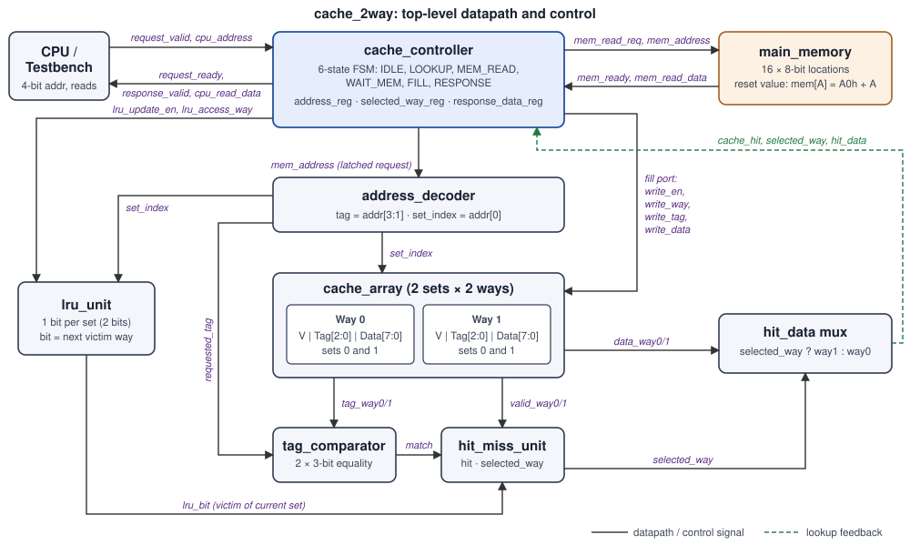
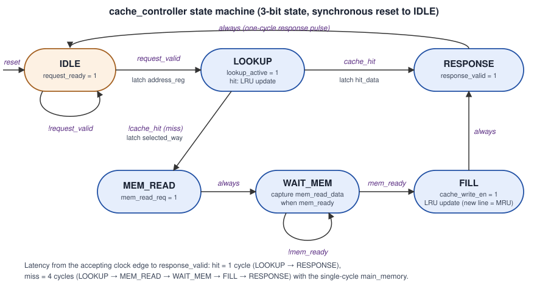

# 2-Way-Set-Associative-Cache

A Verilog-based implementation of a 2-Way Set-Associative Cache with an LRU (Least Recently Used) replacement policy. This project explores cache memory organization, address decoding, tag comparison, hit/miss detection, data storage, and LRU-based cache line replacement through RTL design, simulation, and verification.

## Project deliverables

| Deliverable | Location |
|---|---|
| IEEE project report (PDF) | [`documentation/IEEE_Cache_Project_Report.pdf`](documentation/IEEE_Cache_Project_Report.pdf) |
| IEEE report source (LaTeX, IEEEtran) | [`documentation/report/`](documentation/report/) |
| Literature review and references | [`documentation/literature_review.md`](documentation/literature_review.md) |
| Prototype demo video | _link to be added_ (see [`demo/README.md`](demo/README.md)) |
| RTL source | [`rtl/`](rtl/) |
| Testbenches | [`testbench/`](testbench/) |
| Diagrams | [`diagrams/`](diagrams/) |

## Cache configuration

| Property | Value |
|---|---|
| Address width / data width | 4 bits / 8 bits |
| Sets / ways per set | 2 / 2 |
| Cache lines / line size | 4 / 1 byte |
| Tag / index / offset | 3 / 1 / 0 bits |
| Backing memory | 16 × 8-bit (reset value `mem[A] = 0xA0 + A`) |
| Replacement | Exact LRU, 1 bit per set |
| Access policy | Read-only, allocate on miss |

**Address format**

```
  bit:   3   2   1   0
       +---+---+---+---+
       |    TAG    |SET|
       +---+---+---+---+
  set = A mod 2      tag = A / 2
```

Addresses 0, 2, 4, 6 … map to set 0; addresses 1, 3, 5, 7 … map to set 1.
Either way in the set can hold the address.

## Architecture



| Module | File | Purpose |
|---|---|---|
| `cache_2way` | [`rtl/cache_2way.v`](rtl/cache_2way.v) | Top level; connects all modules |
| `cache_controller` | [`rtl/cache_controller.v`](rtl/cache_controller.v) | 6-state FSM, request handshake, refill, LRU update |
| `address_decoder` | [`rtl/address_decoder.v`](rtl/address_decoder.v) | Splits address into tag and set index |
| `cache_array` | [`rtl/cache_array.v`](rtl/cache_array.v) | Tag, data and valid storage for 2 sets × 2 ways |
| `tag_comparator` | [`rtl/tag_comparator.v`](rtl/tag_comparator.v) | Compares the requested tag with both ways in parallel |
| `hit_miss_unit` | [`rtl/hit_miss_unit.v`](rtl/hit_miss_unit.v) | Valid-qualified hit detection; chooses way (hit → invalid → LRU) |
| `lru_unit` | [`rtl/lru_unit.v`](rtl/lru_unit.v) | One LRU bit per set that names the next victim way |
| `main_memory` | [`rtl/main_memory.v`](rtl/main_memory.v) | 16-byte backing memory with a ready handshake |

### Way selection priority

1. Valid tag match in way 0 → way 0
2. Valid tag match in way 1 → way 1
3. Way 0 invalid → way 0
4. Way 1 invalid → way 1
5. Both ways full → the way named by the LRU bit

The LRU bit is updated on a **hit** (in LOOKUP) and on a **refill** (in FILL),
so the way just accessed becomes most recently used.

### Controller FSM



| Path | States | Latency (accept → `response_valid`) |
|---|---|---|
| Hit | IDLE → LOOKUP → RESPONSE → IDLE | 1 cycle |
| Miss | IDLE → LOOKUP → MEM_READ → WAIT_MEM → FILL → RESPONSE → IDLE | 4 cycles |

## Running the simulations

Requires [Icarus Verilog](https://steveicarus.github.io/iverilog/)
(`brew install icarus-verilog` on macOS, `sudo apt install iverilog` on Ubuntu).
Run the commands from the repository root. The address decoder testbench writes
its waveform to `simulation/waveforms/`.

```bash
# Full cache integration test
iverilog -g2012 -s cache_2way_tb -o cache_2way_tb.vvp rtl/*.v testbench/cache_2way_tb.v
vvp cache_2way_tb.vvp

# Any unit test: replace <name> with address_decoder, tag_comparator, cache_array,
# hit_miss_unit, lru_unit, main_memory or cache_controller
iverilog -g2012 -s <name>_tb -o <name>_tb.vvp rtl/*.v testbench/<name>_tb.v
vvp <name>_tb.vvp
```

View waveforms with [GTKWave](https://gtkwave.sourceforge.net/):
`gtkwave simulation/waveforms/address_decoder.vcd`

### Test results (Icarus Verilog, commit `c8b1374`)

| Testbench | Checks passed | Failures |
|---|---|---|
| `address_decoder_tb` | 16 | 0 |
| `tag_comparator_tb` | 8 | 0 |
| `cache_array_tb` | 9 | 0 |
| `hit_miss_unit_tb` | 9 | 0 |
| `lru_unit_tb` | 11 | 0 |
| `main_memory_tb` | 5 | 0 |
| `cache_controller_tb` | 20 | 0 |
| `cache_2way_tb` | 53 | 0 |

## Key results

Equal-capacity comparison (4 bytes) between the 2-way RTL and a direct-mapped
reference model. Full details are in Section V of the report.

| Trace | Direct-mapped | 2-way LRU (RTL) |
|---|---|---|
| Conflict pair `[0,4]×8` | 0.00 % | **87.50 %** |
| Two sets `[0,1,4,5]×4` | 0.00 % | **75.00 %** |
| Mixed | 12.50 % | **37.50 %** |
| Four-line loop `[0,1,2,3]×4` | 75.00 % | 75.00 % |
| Three tags `[0,2,4]×6` | **27.78 %** | 0.00 % |

Two-way associativity removes conflict misses between two addresses that share
an index. When three addresses compete for one set, though, LRU thrashes and
direct mapping wins. The benefit depends on the access pattern.

## Repository structure

```
.
├── rtl/                    Verilog RTL modules
├── testbench/              Unit and integration testbenches
├── simulation/waveforms/   Waveform dumps and screenshots
├── diagrams/               Block diagram and FSM diagram (SVG)
├── documentation/
│   ├── IEEE_Cache_Project_Report.pdf
│   ├── literature_review.md
│   └── report/             IEEE LaTeX source of the report
└── demo/                   Demo video link and recording plan
```

## Team

| Member | Role | Responsibilities |
|---|---|---|
| Pranjal Shukla ([@Pranjal9005](https://github.com/Pranjal9005)) | Architecture and Integration | Architecture and signal definitions, RTL integration, top-level verification |
| Ritesh Kumar ([@ratinto](https://github.com/ratinto)) | Cache Storage and Address Decoder | Tag arrays, valid bits, data storage, address decoding |
| Meghna Nair ([@heymegzz](https://github.com/heymegzz)) | LRU Replacement Logic | LRU bits, hit-based updates, invalid-way and victim selection |
| Shreya Narayani ([@shreyaa6](https://github.com/shreyaa6)) | Verification and Simulation | Testbenches, hit/miss and LRU tests, waveforms, expected-vs-actual results |
| Nikith Gowda B S ([@nikithcodes](https://github.com/nikithcodes)) | Documentation and Repository | Repository setup, IEEE report, literature review, README and diagrams, video |

## References

1. Cornell University, "Caches," CS 3410, Spring 2025. https://www.cs.cornell.edu/courses/cs3410/2025sp/notes/caches.html
2. UC Berkeley, "Fully Associative Cache," CS 61C Course Notes. https://notes.cs61c.org/content/caches-ii/fully-associative/
3. N. P. Jouppi, "Improving direct-mapped cache performance by the addition of a small fully-associative cache and prefetch buffers," *Proc. 17th ISCA*, 1990, pp. 364–373. doi: 10.1145/325164.325162
4. Icarus Verilog, "Getting Started With Icarus Verilog." https://steveicarus.github.io/iverilog/usage/getting_started.html

More sources are listed in [`documentation/literature_review.md`](documentation/literature_review.md).
